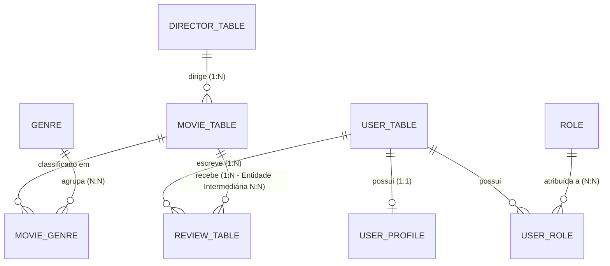

# CineLog Backend API (Kotlin + Spring Boot)

Backend RESTful desenvolvido em **Kotlin** e **Spring Boot 4** para a plataforma **CineLog**, cumprindo todos os requisitos da **Opção 1 – Estendendo os serviços** da disciplina **Backend: Web Services** (Bacharelado em Sistemas de Informação - PUCPR, Prof. Vinícius Godoy Mendonça).

**Vídeo no Youtube:** https://youtu.be/QfGRnU1YIdU?feature=shared

## 👥 Equipe

- **Delrick Ramos** — [GitHub](https://github.com/delrickramos) · [LinkedIn](https://www.linkedin.com/in/delrickramos/)
- **Clara Amazonas** — [GitHub](https://github.com/claraamz) · [LinkedIn](https://www.linkedin.com/in/clara-amazonas-pereira-da-costa-79445635a/)
- **Geovanna Soto** — [GitHub](https://github.com/Geovannayahweh) · [LinkedIn](https://www.linkedin.com/in/geovanna-soto-4aaa9b233/)

---

## 🛠️ Tecnologias Utilizadas

- **Kotlin 2.2** & **Java 21**
- **Spring Boot 4** (Spring Web MVC, Spring Data JPA, Spring Security, Jakarta Validation)
- **JWT (JSON Web Token — JJWT)** para autenticação e autorização stateless
- **H2 Database** (banco de dados em memória)
- **SpringDoc OpenAPI (Swagger UI)** para documentação interativa da API
- **JUnit 5**, **Kotest** e **MockK** para testes unitários

---

## 🏗️ Arquitetura e Entidades (Critérios do Trabalho Final)

O projeto estende a base vista em aula (`User` e `Role`) adicionando **5 novas classes de entidade** no domínio do **CineLog**, cobrindo **todos os 4 tipos de relacionamento JPA** apresentados na disciplina:

1. **`UserProfile`** (`@OneToOne` com `User`): Dados estendidos de perfil do cinéfilo (`bio`, `avatarUrl`, `favoriteMovieQuote`).
2. **`Director`** (`@OneToMany` / `@ManyToOne` com `Movie`): Diretores de cinema (`name`, `nationality`, `birthYear`, `biography`).
3. **`Genre`** (`@ManyToMany` com `Movie` via tabela `MovieGenre`): Gêneros cinematográficos (`name`, `description`).
4. **`Movie`**: Entidade central do catálogo (`title`, `synopsis`, `releaseYear`, `durationMinutes`, `posterUrl`), relacionada a `Director`, `Genre` e `Review`.
5. **`Review`** (Relacionamento **Many-to-Many com entidade intermediária** entre `User` e `Movie`): Avaliações com nota (`rating` de 0 a 10), comentário (`comment`) e data de criação (`createdAt`).

### Diagrama de Entidades e Relacionamentos (MER)



---

## 🔗 Endpoints da API (`/api`)

### Autenticação e Usuários (`/api/users` & `/api/roles`)
| Método | Rota | Auth | Descrição |
|---|---|---|---|
| `POST` | `/api/users/login` | Público | Autentica usuário e retorna token JWT (`Bearer`) |
| `POST` | `/api/users` | Público | Cadastra novo usuário |
| `GET` | `/api/users?role={role}&sortDir={ASC\|DESC}` | Público | Lista usuários com filtro por papel e ordenação |
| `GET` | `/api/users/{id}` | Público | Busca usuário por ID (inclui `profile` e `roles`) |
| `PATCH` | `/api/users/{id}` | JWT (`Dono` ou `ADMIN`) | Atualiza o nome do usuário |
| `PUT` | `/api/users/{id}/profile` | JWT (`Dono` ou `ADMIN`) | Cria ou atualiza o `UserProfile` (`@OneToOne`) do usuário |
| `PUT` | `/api/users/{id}/roles/{name}` | JWT (`ADMIN`) | Associa um papel (`Role`) ao usuário |
| `DELETE` | `/api/users/{id}` | JWT (`ADMIN`) | Remove usuário (impede exclusão do último `ADMIN`) |
| `GET` | `/api/roles` | Público | Lista papéis cadastrados |
| `POST` | `/api/roles` | JWT (`ADMIN`) | Cadastra novo papel |

### Filmes (`/api/movies`) — *CRUD Completo + Associações + Filtros e Ordenação*
| Método | Rota | Auth | Descrição |
|---|---|---|---|
| `GET` | `/api/movies?genre=&directorId=&minYear=&title=&sortDir=ASC\|DESC` | Público | Consulta com **filtragem combinada e ordenação** via query params |
| `GET` | `/api/movies/{id}` | Público | Detalhes do filme (inclui diretor e gêneros) |
| `POST` | `/api/movies` | **JWT (`ADMIN`)** | Cadastra novo filme |
| `PUT` | `/api/movies/{id}` | **JWT (`ADMIN`)** | Atualiza todos os dados de um filme |
| `PATCH` | `/api/movies/{id}` | **JWT (`ADMIN`)** | Atualização parcial de um filme |
| `DELETE` | `/api/movies/{id}` | **JWT (`ADMIN`)** | Exclui um filme |
| `PUT` | `/api/movies/{id}/genres/{genreName}` | **JWT (`ADMIN`)** | **Associa** um gênero (`Genre`) ao filme |
| `DELETE` | `/api/movies/{id}/genres/{genreName}` | **JWT (`ADMIN`)** | **Desassocia** um gênero (`Genre`) do filme |
| `PUT` | `/api/movies/{id}/director/{directorId}` | **JWT (`ADMIN`)** | **Associa** um diretor (`Director`) ao filme |
| `DELETE` | `/api/movies/{id}/director` | **JWT (`ADMIN`)** | **Desassocia** o diretor do filme |

### Diretores (`/api/directors`) — *CRUD Completo*
| Método | Rota | Auth | Descrição |
|---|---|---|---|
| `GET` | `/api/directors?nationality=&sortDir=ASC\|DESC` | Público | Lista diretores com filtro por nacionalidade e ordenação |
| `GET` | `/api/directors/{id}` | Público | Busca diretor por ID |
| `POST` | `/api/directors` | **JWT (`ADMIN`)** | Cadastra novo diretor |
| `PUT` | `/api/directors/{id}` | **JWT (`ADMIN`)** | Atualiza todos os dados do diretor |
| `PATCH` | `/api/directors/{id}` | **JWT (`ADMIN`)** | Atualiza parcialmente o diretor |
| `DELETE` | `/api/directors/{id}` | **JWT (`ADMIN`)** | Exclui um diretor |

### Gêneros (`/api/genres`) — *CRUD Completo*
| Método | Rota | Auth | Descrição |
|---|---|---|---|
| `GET` | `/api/genres?sortDir=ASC\|DESC` | Público | Lista gêneros ordenados |
| `GET` | `/api/genres/{id}` | Público | Busca gênero por ID |
| `POST` | `/api/genres` | **JWT (`ADMIN`)** | Cadastra novo gênero |
| `PATCH` | `/api/genres/{id}` | **JWT (`ADMIN`)** | Atualiza descrição do gênero |
| `DELETE` | `/api/genres/{id}` | **JWT (`ADMIN`)** | Exclui um gênero |

### Avaliações e Comentários (`/api/reviews` & `/api/movies/{movieId}/reviews`)
| Método | Rota | Auth | Descrição |
|---|---|---|---|
| `POST` | `/api/movies/{movieId}/reviews` | **JWT (`Dono` ou `ADMIN`)** | Cria avaliação associando `User` (padrão: usuário autenticado) e `Movie` |
| `GET` | `/api/movies/{movieId}/reviews?sortDir=ASC\|DESC` | Público | Lista avaliações de um filme ordenadas pela nota |
| `GET` | `/api/movies/{movieId}/reviews/stats` | Público | Retorna média de notas e total de avaliações do filme |
| `GET` | `/api/reviews?movieId=&userId=&minRating=&sortDir=ASC\|DESC` | Público | Consulta global de avaliações com filtros e ordenação |
| `GET` | `/api/reviews/{id}` | Público | Busca avaliação por ID |
| `PATCH` | `/api/reviews/{id}` | **JWT (`Dono` ou `ADMIN`)** | Atualiza nota ou comentário da avaliação |
| `DELETE` | `/api/reviews/{id}` | **JWT (`Dono` ou `ADMIN`)** | Exclui uma avaliação |

---

## 🚀 Como Executar e Testar

1. **Subir o servidor:**
   ```bash
   ./gradlew bootRun
   ```
2. **Endereços da aplicação:**
   - **Swagger UI (OpenAPI):** `http://localhost:8080/api/swagger-ui/index.html` (ou `http://localhost:8080/api`)
   - **Health Check:** `http://localhost:8080/api/health`
   - **H2 Console:** `http://localhost:8080/api/h2-console` (`jdbc:h2:mem:cinelogdb`, usuário `sa`, senha `sa`)
3. **Credenciais iniciais carregadas pelo `BootStrapper`:**
   - **Admin:** `email`: `admin@cinelog.com` | `password`: `admin`
   - **Reviewer:** `email`: `delrick@cinelog.com` | `password`: `1234`
4. **Executar a suíte de testes unitários (JUnit 5 + Kotest + MockK):**
   ```bash
   ./gradlew test
   ```
